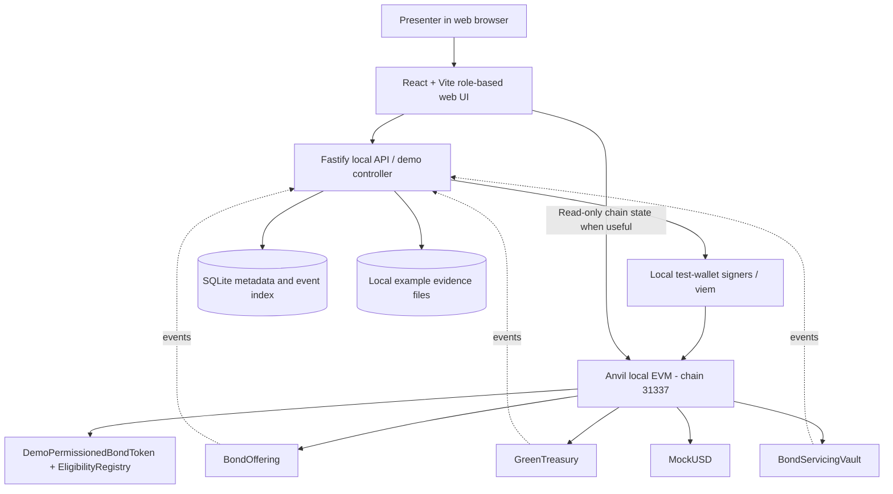
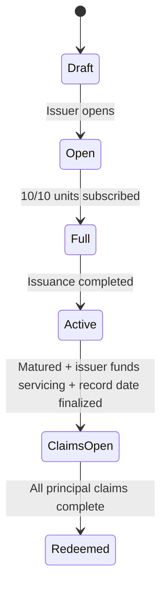
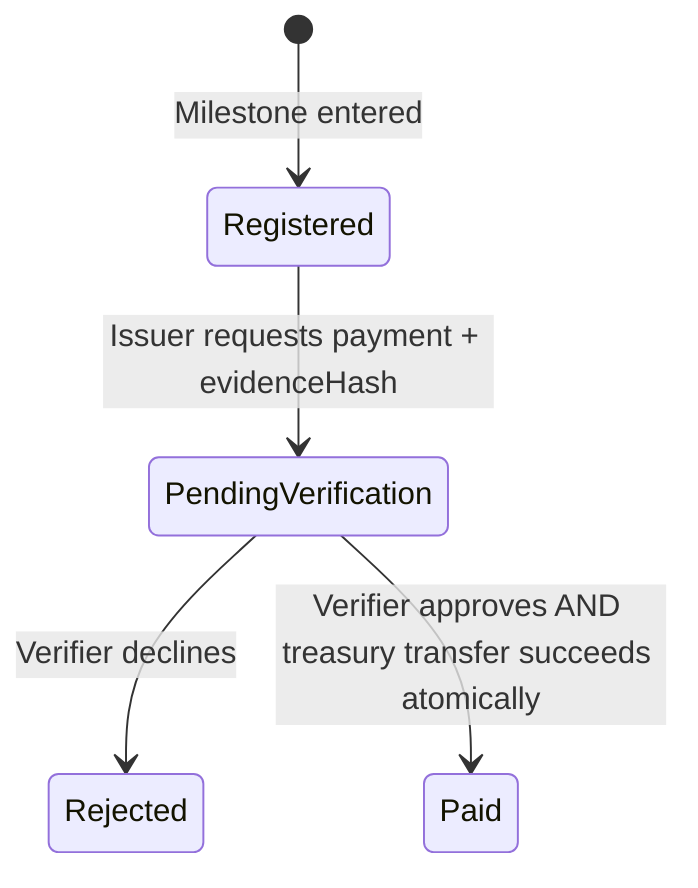

# GreenFlow Bond — MVP Implementation Blueprint

**Version:** 1.0 · **Prepared:** 26 October 2026 · **Status:** Implementation-ready specification · **Intended audience:** Software implementation agent and BF3124 student team

> **Objective:** Produce a reliable, presentation-first, interactive MVP of **GreenFlow Bond**, showing how tokenised green-bond subscriptions fund a segregated treasury and how smart contracts **prevent disbursement of green-bond proceeds unless project, vendor, budget and milestone-verification controls all pass**. Demonstrate compliant investor access, investor transparency and basic bond servicing. The prototype operates on a **local EVM**, not a public network, and uses **only simulated money and fictional parties**.

## 0. Source basis, priorities, and truth in presentation

### 0.1 Source-derived project promises
This blueprint implements the product described in the group's press release, *“GreenFlow Launches Programmable Tokenised Green Bond Platform to Strengthen Control Over Green Finance”* (1 October 2026):
- A tokenised green bond on Polygon; investor-eligibility enforcement described as ERC-3643/ONCHAINID.
- Investors subscribe using cash; proceeds sit under programmable treasury controls.
- Authorised verifiers register/confirm approved green projects, vendors, spending limits and milestones.
- Only compliant, verified milestone-driven payments can be released; evidence hashes and disbursements are recorded on-chain.
- Investors can monitor allocations, balances, milestone completion and disbursements.
- Coupon payments and principal redemption are part of the proposed product.
- Differentiator: enforce the **approved use of proceeds at the point of payment**, not just issue an on-chain bond or publish an after-the-fact report.

The BF3124 group-project slides require (a) smart contracts/on-chain logic, (b) an interactive frontend and (c) deployment on a blockchain environment; the prototype accounts for 15% of the course grade. The presentation is a 20-minute investor pitch with 15-minute Q&A (15% of course grade). **Project-team decision for this MVP:** no public-chain deployment yet; a deterministic local EVM demonstrates actual execution, while Polygon Amoy deployment remains Phase 6. **Do not assert that a locally run demo meets a public-chain deployment requirement.**

### 0.2 Design additions (not factual claims from the press release)
The fictional issuer, numerical bond terms, simulated dollar token, two-vault structure, interface routes, local signers, event indexing and phase priorities below are implementation decisions made to deliver a coherent demonstration. They are **not** claims about the actual GreenFlow business, regulatory approval, ICMA certification or live financing.

### 0.3 Non-negotiables
1. **Real on-chain rule enforcement in the local MVP:** The treasury cannot rely on UI-only validation. If any payment condition fails, funds do not move.
2. **Truthful boundary marking:** Mock USDC has no value; KYC decisions and environmental approvals are simulated; no real bank money, actual green-impact certification or deployed Polygon contracts.
3. **End-to-end coherence:** Investment proceeds, green disbursements and debt-servicing funds are accounted for separately.
4. **One-click repeatability:** Presenters can reset/seed a fixed state and re-run the demo without external network dependencies.
5. **One narrative:** Every core screen must support the scripted funding story below.
6. **No production-security claims:** No real private keys or customer personal information; keys used for the demo are public test fixtures.

## 1. Product boundaries and definition of done

### 1.1 MVP (required)
- Functional local chain with Solidity contracts executed by local test signers; real transaction receipts and event logs.
- Role-based web UI: Presenter switcher, Issuer, Investor, Verifier and Admin views.
- One green bond offering: settings, subscribe, gated token mint and investment receipt.
- Simulated compliance: verified and unverified investor accounts; enforce transfer restrictions on-chain.
- Issuer-proposed project spending policy; verifier-authorised project, vendors and budget/milestones, stored as binding on-chain rules.
- Issuer submits payment request with evidence hash; independent verifier approves/declines. The issuer cannot unilaterally authorise its own spending policy.
- Approval and actual vendor payout **atomically** in the same on-chain transaction, but only if the full set of treasury checks passes.
- Demonstrable blocked cases: before approval, unapproved vendor, over-budget, duplicate execution, ineligible investor, unauthorised verifier, insufficient treasury funds.
- Investor-facing real-time balances, allocations, milestone states, paid vendor records, on-chain tx references and hashed evidence.
- Separate servicing vault: issuer deposits simulated funds; one coupon distribution period and maturity principal redemption; double claim prevention.
- Local evidence upload and integrity verification (files stored off-chain; only hashes on-chain).
- Backend/local demo controller supporting a safe, deterministic reset, plus reproducible build/test commands.

### 1.2 Out of scope for MVP
- Public Polygon deployment, genuine asset custody, actual bank cash or stablecoin redemption, real investor onboarding, legal securities issuance, production-grade ERC-3643 attestation providers, formal financial audit, live environmental impact oracle, secondary bond marketplace, fiat on/off ramps, cross-chain bridging, multiple issuers, automated bond price discovery or advanced analytics.
- Do not let these future capabilities become blockers to demonstrating GreenFlow's core business logic.

### 1.3 Explicit treatment of ERC-3643
**Preferred end state:** The protocol uses the official ERC-3643/T-REX suite with ONCHAINID, Identity Registry, trusted claim issuer, compliant transfer checks, freeze/recovery/agent controls. This requires real integration work; a custom ERC-20 plus whitelist **is not an ERC-3643 token**.

**Feasible MVP default:** Ship an explicitly named **DemoPermissionedBondToken** with a separate **DemoInvestorEligibilityRegistry**, implemented on the local EVM. It enforces KYC-demo flags, investor transfer restrictions, approved mint/burn authorities and role-based actions. The frontend labels this **“Demo compliance simulation — ERC-3643/ONCHAINID integration planned”**. Provide a `BondTokenAdapter` abstraction that can be replaced by a real T-REX adapter. An early spike (Phase 1) evaluates whether local deployment of the official suite can replace the default without jeopardising the end-to-end demo. **Never advertise the simplified contract as ERC-3643-compliant.**

The ERC-3643 standard includes transfer compliance, identity/claims, and additional agent/freeze/recovery features beyond a simple whitelist. References: https://eips.ethereum.org/EIPS/eip-3643 and https://github.com/ERC-3643/ERC-3643.

### 1.4 Global acceptance (release gate)
- `pnpm demo:start` starts local EVM, deploys/initializes contracts, seeds demo users and content, starts API and UI, and prints the demo URL and addresses. Exact scripts can vary if documented but must offer equivalent **single-command operation**.
- All required story scenes can be completed from the web UI, without Remix, CLI calls or manual contract interaction.
- A user cannot release a cent of mock proceeds when a treasury rule fails—even by calling contracts directly.
- At least one successful release and five distinct blocked attempts are automatically tested and visible in the demo.
- Values, receipts and user-visible balances come from the chain; no fake “success” popups unrelated to confirmed transactions.
- Reset returns the app to the same known seed state and balances within one command.
- UI visibly says “DEMO • local blockchain • mock USD • simulated identities / verification”.

## 2. Canonical demo story and finances

**Issuer:** GreenSun Energy Pte Ltd (fictional). **Offering:** GreenSun Solar Green Bond 2026, symbol `GSGB`, whole bond units (0 decimals). **One bond unit face value:** 100 mock USD. **Supply:** 10 bonds; **total proceeds:** 1,000 mock USD. **Coupon:** 5% annual; one simulated annual payment: 5 mock USD per bond. **Term:** one illustrative period; maturity simulated through controlled local-chain time advancement (not changing business logic).

**Investors:** Alice subscribes 6 units for 600; Bob subscribes 4 units for 400. Ineligible Charlie holds mock USD but cannot subscribe or receive security tokens. Identity/eligibility decisions are seeded fictional claims.

**Green project:** Solar Panels for Community Facilities (`PROJECT-001`), approved max budget 800. **Vendor A:** SolarSupply Pte Ltd (approved wallet). **Vendor B:** UnknownVendor (unapproved wallet).

**Milestones:** `M1`: equipment delivery approved up to 300; `M2`: installation completion approved up to 500. Both permit one payment each; partial payments and change orders are out of scope. `M1` demonstrates the live approval/payout. `M2` can be preseeded pending and executed later if time allows.

**Demo money flows** (all mock USD):

| Movement | Green proceeds treasury | Bond servicing vault | Vendor A |
|---|---:|---:|---:|
| After subscriptions | 1,000 | 0 | 0 |
| After approved M1 vendor payment | 700 | 0 | 300 |
| After approved M2 vendor payment | 200 | 0 | 800 |
| Issuer separately funds servicing | 200 | 1,050 | 800 |
| Alice/Bob each claim 5% coupon | 200 | 1,000 | 800 |
| Alice/Bob redeem 1,000 principal | 200 | 0 | 800 |

**Important:** the untouched 200 of green-bond proceeds remains ring-fenced; it is **not** silently swept into debt servicing. The 1,050 in the separate servicing vault is provided by the fictional issuer from an independent simulated source. Real-life repayment is a credit obligation, not guaranteed by the token technology. Include a visible disclaimer.

**Narrative scenes:**
1. Admin previews demo identities; Charlie cannot buy.
2. Issuer opens green bond offering; Alice and Bob subscribe; tokens issued; Treasury 1,000.
3. Issuer proposes PROJECT-001 with Vendor A and M1/M2 budgets; independent verifier authorises the spending policy before any payment request is valid. Issuer submits M1 payment of 300 with evidence file.
4. Presenter tries “release before verification” → rejected; tries Vendor B → rejected.
5. Verifier views evidence, approves M1; **smart contract immediately transfers 300 to Vendor A**; receipt/event shown.
6. Issuer attempts duplicate and/or oversized payment → rejected without moving funds.
7. Investor sees projected budgets, verified payment, remaining 700 (then 200 if M2 executed), hashes and actor/audit trail.
8. Issuer funds servicing vault; presenter advances local demo clock; Alice/Bob claim 50 total coupon and 1,000 principal; balances reconcile.

## 3. Personas, roles and permissions

All “actors” are local demo wallets controlled by a **server-side presenter simulator**. Clicking “Switch role” changes the selected demo actor; the backend uses that actor's deterministic local signing key. There is no real identity authentication in this presenter mode, and the interface must clearly disclose this. On-chain AccessControl remains authoritative.

| Role | Can do | Cannot do |
|---|---|---|
| Platform Admin | Register issuer/verifier, configure demo eligibility, freeze/stop demo contracts, reset local demo | Approve a project milestone unless separately granted VERIFIER_ROLE |
| Issuer (GreenSun) | Create offering, **propose** green project/vendor/milestone spending policy, request disbursement, fund servicing | Approve its own proposed policy, approve its own milestone, or bypass treasury rules |
| Verifier (Independent Green Audit) | Authorise proposed project/vendor/budget/milestone **policy**, review completion evidence, approve-and-release or reject pending payment | Create issuer disbursement requests or silently change locked policy once funding requests exist |
| Investor Alice/Bob | Subscribe if eligible, see bond holdings/green use-of-proceeds and claim distributions | Register vendors, change milestones, release proceeds |
| Investor Charlie (ineligible) | See demo compliance failure, optionally hold mock USD | Subscribe, receive or transfer the restricted bond |
| Approved Vendor A | Receive and inspect mock USD payment | Request/verifiy/trigger disbursements |
| Unapproved Vendor B | None regarding treasury | Receive milestone payments |
| Presenter (UI only) | Switch among fictional wallets, run scenario reset, advance demo time | No corresponding privileged on-chain role |

Security note: the demo switcher is available **only on localhost**. Production requires genuine wallet signatures and authentication, and must **never** ship sample private keys.

## 4. Functional requirements / user stories

Priorities: **P0** = necessary for coherent demo; **P1** = necessary for the full promised story (but can be completed after P0); **P2** = optional polish/roadmap. Every FR includes an observable acceptance outcome.

### 4.1 Presenter and setup

| ID | Priority | User story / requirement | Acceptance criterion |
|---|---|---|---|
| FR-001 | P0 | As a presenter, I can load/reset the entire story with fixed sample wallets and balances. | One command or guarded button restores deterministic states and restarts event sync. |
| FR-002 | P0 | As a presenter, I can switch between issuer, verifier, approved investor and ineligible investor without logging into live accounts. | Active role + demo address shown; requests actually signed by selected local actor. |
| FR-003 | P0 | As any actor, I see a prominent local-demo / mock-money disclosure and chain status. | Status always visible; show connection error if Anvil is down. |
| FR-004 | P1 | As a presenter, I can open a scenario guide and mark demo scenes complete. | Scene checklist mirrors Section 2; no data mutation necessary. |

### 4.2 Bond issuance and eligibility

| ID | Priority | User story / requirement | Acceptance criterion |
|---|---|---|---|
| FR-005 | P0 | As the issuer, I can create/open the fixed GreenSun green-bond offering. | Offering terms on-chain; only issuer can open; cap/price fixed for this sample. |
| FR-006 | P0 | As a verified investor, I can purchase whole bond units with mock USD. | Atomic mock USD payment to treasury + bond mint; balances and tx hash update. |
| FR-007 | P0 | As an unverified investor, I am prevented from subscription and receiving bond tokens. | Contract rejects attempts even if API or UI is bypassed; treasury unchanged. |
| FR-008 | P0 | As an admin, I can inspect/change seeded demo investor eligibility. | Demo registry event reflects change; UI refreshes; only registrar role may modify. |
| FR-009 | P1 | As a holder, I can see how transfer restrictions block transfer to ineligible wallets. | Attempted transfer fails; transfer to eligible holder allowed before lifecycle freeze if supported. |
| FR-010 | P2 | As a compliance operator, I can create actual ONCHAINID and required claim topics using T-REX suite. | Replace demo registry/token adapter and pass genuine T-REX integration tests. |

### 4.3 Project treasury and environmental approvals

| ID | Priority | User story / requirement | Acceptance criterion |
|---|---|---|---|
| FR-011 | P0 | As issuer, I can **propose** a project, vendors and milestone spending caps. | Draft proposal visible to verifier; proposal alone gives no payment authority. |
| FR-012 | P0 | As verifier, I can independently **authorise** the proposed project, approved vendor list and project budget. | Canonical approved policy stored on-chain only after verifier-signed approval; Vendor B blocked. |
| FR-013 | P0 | As verifier, I authorise M1/M2 spending limits and vendor mapping with the project policy. | On-chain M1 $300, M2 $500, project cap $800; issuer cannot unilaterally change an active policy. |
| FR-014 | P0 | As issuer, I can upload evidence and submit a milestone payment request. | Evidence stored off-chain, SHA-256 saved on-chain, request becomes `PendingVerification`. |
| FR-015 | P0 | As verifier, I can view evidence and approve a pending request. | Verifier's on-chain signature/tx; **approve-and-release atomically pays approved vendor**. |
| FR-016 | P0 | As verifier, I can reject a pending request with an explanation. | Request becomes Rejected; no money moved; reason is off-chain metadata, event includes reason code. |
| FR-017 | P0 | As investor, I can see the amount disbursed per milestone and budget remaining. | UI derives balances from confirmed chain events/state, not editable fields. |
| FR-018 | P0 | As system, I must block unverified / wrong-vendor / over-budget / duplicate / insufficient-fund payment. | Direct negative tests revert and preserve balances; error shown clearly in UI. |
| FR-019 | P1 | As platform controller, I can pause/unpause treasury payments. | Only authorized admin can pause; attempts under pause revert. |
| FR-020 | P1 | As investor, I can download evidence and compare its SHA-256 to the committed value. | Integrity-check UI displays Match / Mismatch using full file hash. |

### 4.4 Investor transparency and debt servicing

| ID | Priority | User story / requirement | Acceptance criterion |
|---|---|---|---|
| FR-021 | P0 | As investor, I can view my investment balance and bond metadata. | Accurate number of bond units, face value, issuance cap and role eligibility. |
| FR-022 | P0 | As investor, I can inspect all green-disbursement events, hashes and request/approval actor wallets. | Confirmed tx hash + block number + milestone/project context; local tx detail viewer. |
| FR-023 | P1 | As issuer, I can separately fund a servicing vault. | Vault balance increases without changing green treasury balance. |
| FR-024 | P1 | As investor, I can claim one coupon payment after record-date finalization. | Alice receives 30 and Bob 20; claim twice fails. |
| FR-025 | P1 | As investor, I can redeem principal at maturity. | Alice receives 600 and Bob 400; bonds burned; double redemption fails. |
| FR-026 | P1 | As presenter, I can advance the local EVM clock into maturity without waiting months. | Explicit “Simulate maturity” control triggers local EVM time travel; not shown as real elapsed time. |
| FR-027 | P1 | As auditor/investor, I can see green spending and servicing payments in separate ledgers. | Treasury and servicing vault distinct; both account flows reconcile. |

### 4.5 Important non-goals for the app UI
- Do not build complete KYC forms with personal identification details; toggle fictional status/claim flags instead.
- Do not pretend approvals prove environmental performance. A verifier confirms fictional milestone evidence, not CO2 avoided.
- Do not add attractive but nonfunctional “Withdraw,” “Trade on DEX,” “Cash out to Bank” actions.
- Do not make the app look like a public investment solicitation; “Fictional product / demonstrator” is visible.

## 5. Non-functional requirements (NFRs)

| ID | Attribute | Requirement & verification |
|---|---|---|
| NFR-01 | Reliability | Demo reset/start works from clean checkout with documented dependencies. Test twice end-to-end; no external RPC required. |
| NFR-02 | Accuracy | All mock money uses integer smallest units (`uint256`, 6 decimals); bond units use integer lots. Never use JS floating point for accounting. |
| NFR-03 | Security | On-chain role checks for every privileged operation; no bank credentials or real keys; local backend binds to `127.0.0.1`. |
| NFR-04 | Financial invariants | (1) Subscription total = minted lots × face amount; (2) cumulative paid ≤ milestone budget and project cap; (3) no duplicated payout; (4) unapproved vendor paid amount = 0; (5) no servicing from green treasury. |
| NFR-05 | Performance | On ordinary development laptop, local normal UI actions render in ~2 s and local mined transactions appear within ~5 s; show Pending/Succeeded/Rejected lifecycle rather than asserting instant completion. Targets, not external SLAs. |
| NFR-06 | Auditability | Every money-moving action emits named event with caller, project/request IDs, currency amount and contract/tx hash; evidence file digest can be checked. |
| NFR-07 | Determinism | Seed accounts, test data, IDs, balances and local chain snapshots are reproducible. No dependence on faucets. |
| NFR-08 | Usability | Role-aware navigation; visible local-demo strip; human-readable reasons for rejection; no developer tooling required during demo. |
| NFR-09 | Accessibility | Semantic labels, focus-visible, keyboard-usable buttons/forms, readable contrast; no color-only status indicators. |
| NFR-10 | Maintainability | TypeScript strict mode, contract unit tests, typed ABI, structured API errors, minimal documented modules; no hard-coded balances in UI. |
| NFR-11 | Privacy | Store no real PII or sensitive supplier documents; hashes on chain, demo sample files only; warn blockchain events are public on public deployment. |
| NFR-12 | Integrity | API independently checks local demo actor/role but contract is authoritative; evidence hash computed from original bytes before record creation. |
| NFR-13 | Observability | Debug panel shows RPC status, last tx receipt, events, chain id and contract addresses; failures provide traceable error codes. |
| NFR-14 | Testability | Unit + integration + browser e2e scripts included; CI or one local verification command. |
| NFR-15 | Resilience | Frontend handles chain restart/outdated contract addresses gracefully, prompting reset/reseed instead of displaying stale success. |
| NFR-16 | Financial truth | The UI distinguishes committed green proceeds, actual disbursements, unspent balance, and issuer-funded debt servicing. |

## 6. Architecture and system context

### 6.1 Chosen pragmatic stack

- **Local blockchain and Solidity testing:** Foundry (`anvil`, `forge`, Solidity 0.8.24). `anvil` provides prefunded local wallets, instant mining, timestamps and event receipts; no remote RPC. Chain ID 31337.
- **Contract libraries:** OpenZeppelin Contracts v5 for ERC-20 primitives, AccessControl, SafeERC20, ReentrancyGuard, Pausable.
- **Web frontend:** React + Vite + TypeScript + Tailwind CSS; React Router; TanStack Query for client reads/state; Recharts optional for expenditure bar chart (visual polish only).
- **Local API/role simulation:** Node.js + Fastify (TypeScript), `viem` for JSON-RPC reads/writes/receipts. Private demo signers ONLY in backend. Expose local-only API.
- **Off-chain metadata:** SQLite + Drizzle ORM (or equivalent light ORM) and local `uploads/` folder. Chain is source of truth for balances, roles, eligibility, budgets, releases and payout states; SQLite for file metadata, display names, verifier notes and presenter timeline.
- **Package manager:** pnpm workspace. GitHub not required for presentation, but repository should be version-controlled.

**Alternative:** If the team is already comfortable with Hardhat, Hardhat Network can replace Foundry/Anvil with equivalent functionality; use one EVM environment, do not split testing across both without a reason.

### 6.2 Component and data-flow diagram



### 6.3 Data ownership and trust boundaries
- **On-chain canonical:** investor eligible status in demo registry; token balances; registered project & vendor wallets; project/milestone caps; payment request identifiers/status; approved/paid amounts; treasury balances; coupon/principal claims; authority roles.
- **Off-chain authoritative for none of the rules:** project names/descriptions, supporting invoices/images, verifier review notes, UI actor labels and presentation status. Store on-chain hash of the specific evidence bytes and reference project metadata hash where appropriate.
- **Trusted off-chain actors:** the fictional verifier validates environmental evidence (oracle problem). The platform does **not** automatically detect physical milestone truth. The issuer remains responsible for the legal security and repayments.
- **Simulation boundary:** backend holds test-only private keys to streamline demo. Not acceptable for production.
- **Immutable audit facts:** successful chain transactions and events. UI-only failure logs reflect attempted, rejected actions; a transaction reverted on-chain cannot leave persistent on-chain events from that reverted execution.

### 6.4 UI route/navigation plan

| Route | Actor | Content / principal actions |
|---|---|---|
| `/demo` | Presenter | Scene runner, role switch, reset, story guide, simulation notices, chain health. |
| `/issuer/offerings` | Issuer | Offering summary, create/open, issuance cap, amount raised, subscriptions. |
| `/issuer/treasury` | Issuer | Green treasury available, **draft policy proposal**, verified/approved policy, new disbursement requests and statuses. |
| `/verifier` | Verifier | Pending **policy authorisations** plus payment milestone evidence, sha256 digest, approve-and-release, reject; actor signer's wallet. |
| `/investor` | Alice/Bob/Charlie | Eligibility, subscribe, holdings, coupon/principal claim, transaction history. |
| `/impact` | All roles | **Use-of-proceeds view**, not environmental impact claim: allocation vs payout vs balance, milestones, evidence references and txs. |
| `/admin` | Admin | Simulated investor flags, roles, pause controls, registry and audit debug. |
| `/transactions/:hash` | All roles | Local transaction detail (status, timestamp, actor, contract, event names, amount). No dependency on external explorer. |

**UI components:** `DemoBanner`, `ActiveActorSwitch`, `ChainHealthIndicator`, `BondOfferingCard`, `TreasuryKpiTiles`, `ProjectBudgetMeter`, `MilestoneStepper`, `PaymentRequestForm`, `VerifierEvidenceCard`, `EligibilityBadge`, `TransactionReceiptDrawer`, `InvestorHoldings`, `ServiceVaultCard`, `DemoScenarioChecklist`.

**Presenter UX:** No MetaMask popup required; role switch triggers the local backend test signer. Every action displays a confirmation dialog naming the fictional actor, chain, payment amount and recipient before submitting. No dead buttons. `Reset` requires confirmation, and never exposes unguarded destructive operations outside localhost.

## 7. Solidity contract architecture (local MVP)

### 7.1 `MockUSD.sol`
- OpenZeppelin ERC20, 6 decimals; deployer has `FAUCET_ROLE` restricted to demo setup.
- Initially distribute ≥1,000 to Alice, ≥1,000 to Bob, ≥1,050 from independent issuer source; Charlie receives sufficient demo balance to test ineligible subscription.
- Only `MockUSD` represents project cash in on-chain treasury.
- Not linked to live USDC or any stablecoin reserves.

### 7.2 `DemoInvestorEligibilityRegistry.sol`
- `REGISTRAR_ROLE`: admin; mapping wallet → `eligible`, `claimExpiry`, optional `jurisdictionCode`/`accredited` for illustrative UI.
- Public `isEligible(address)` returns true only if active flag and not expired.
- Record event `EligibilitySet(investor,eligible,expiry,registrar)`.
- No private KYC information on-chain. This is a **mock identity flag**, NOT actual ONCHAINID issuance.
- Later: replace with official T-REX Identity Registry / ONCHAINID claim structure if Phase 1 spike succeeds.

### 7.3 `DemoPermissionedBondToken.sol`
- ERC20 structure with **0 decimals** (10 integer bond units), immutable maxSupply 10, `MINTER_ROLE` given only to `BondOffering`, `BURNER_ROLE` to `BondServicingVault`.
- Mint checks `isEligible(to)`; transfer/transferFrom check receiving wallet eligibility and token pause/freeze status.
- `freezeAtRecordDate()` by servicing vault prevents **holder-to-holder transfers** during coupon/principal claim period (but must still permit authorised redemptive burns); not optional if balances are used for payouts. Note exact function can be in token or vault; the ability to freeze must be enforceable.
- Do not implement unlimited admin force transfer without test and investor-rights rationale. Seed data makes trading unnecessary.
- **No false ERC-3643 conformity claim**. Interface design must let the frontend call the same business actions when a T-REX adapter is substituted.

### 7.4 `BondOffering.sol`
- Parameters: token address, MockUSD address, GreenTreasury address, faceValue = 100 × 10^6, cap 10 units, owner issuer.
- `openOffering()` issuer-only; state DRAFT→OPEN.
- `subscribe(uint256 units)` while OPEN: units > 0, holder eligible, sum <= cap, sufficient allowance/balance. Using `SafeERC20.safeTransferFrom(msg.sender, address(treasury), totalPrice)`, then mint units, all in one transaction so failure reverts all effects.
- Contract cannot reassign proceeds to the servicing vault.
- Emit `Subscribed(investor, units, paidAmount)`.
- After cap reached: state FULL; issuer may activate servicing lifecycle.
- **Correct money model:** for backend-signed investor actions the `msg.sender` must be the actor's wallet; never transfer from a generic system wallet and pretend it was Alice.

### 7.5 `GreenTreasury.sol` (the centrepiece)
- Holds MockUSD subscription proceeds. Roles: `ISSUER_ROLE`, `VERIFIER_ROLE`, `ADMIN_ROLE`; admin cannot approve unless granted verifier explicitly. **Policy creation/activation is a verifier power, never an issuer power.**
- Data structures (conceptual; optimize structs for gas pragmatically):
  - `Project`: `id`, `budget`, `spent`, `active`, `metadataHash`.
  - `VendorPermission`: projectId + address → bool.
  - `Milestone`: `id`, `projectId`, `vendor`, `maxAmount`, `spent`, `evidenceHash`, `state`.
  - `PaymentRequest`: `id`, `milestoneId`, `vendor`, `amount`, `evidenceHash`, `requester`, `status`.
- Scope: one project with two milestones, but structure supports multiple records.
- Contract methods **(suggested API, implementation agent may rename consistently):**
  - `registerApprovedPolicy(projectId, budget, metadataHash, vendors[], milestoneSpecs[])` **verifier-only**; called by local API after verifier has reviewed issuer's off-chain draft proposal. Atomically registers the approved project/vendor/milestone policy with total milestone caps ≤ project budget, nonzero allowed vendors and unique milestone IDs. `milestoneSpecs` include ID, allowed vendor, max spend. Only this signed transaction makes policy active.
  - **Issuer proposal workflow:** issuer records a pending proposed green-spending plan in SQLite; this draft has no on-chain payment authority. The verifier can explicitly approve it using `registerApprovedPolicy` or reject it. Changes after activation require a new verifier-approved version and must not retroactively modify pending requests (out of scope; freeze approved plan for MVP).
  - `requestDisbursement(requestId,milestoneId,vendor,amount,evidenceHash)` issuer-only; check **verifier-authorised** project/milestone active, vendor approved, vendor == milestone vendor, amount >0, amount ≤ milestone cap, one request per unpaid milestone. Set PENDING. Request created **without releasing any money**.
  - `approveAndRelease(requestId)` verifier-only, not original requester. Re-check **all** conditions against current canonical state, block if paused/insufficient, mark PAID before external token transfer, use ReentrancyGuard + SafeERC20, emit `MilestoneVerified`, `DisbursementReleased`. **Approval and transfer are atomic**; if token transfer fails, state reverts to PENDING.
  - `rejectRequest(requestId,reasonCode)` verifier-only; sets REJECTED; no transfer.
  - `pauseDisbursements`/`unpauseDisbursements` admin-only.
  - `getProject`/`getMilestone`/`getRequest` and aggregate read helpers.
- Hard constraints: (0) issuer cannot approve or amend its own authorised spending policy; (1) project `spent + amount ≤ budget`; (2) milestone `spent + amount ≤ max`; (3) exactly one paid request per milestone; (4) vendor approved in specific project and matches specified milestone; (5) request approval requires independent verifier role; (6) amount and receiver cannot be changed after request; (7) enough treasury token balance; (8) no payout while paused; (9) issuer cannot withdraw or drain treasury through an unguarded function.
- Events: `ProjectPolicyApproved`, `DisbursementRequested`, `MilestoneVerified`, `DisbursementRejected`, `DisbursementReleased`.
- A premature attempt to call `approveAndRelease` from issuer or a role without verification **reverts** and does not spend funds. For an explicit “release before verification” scene, add an issuer-facing `attemptDisbursement(requestId)` *only if* it runs the same verified-state checks; preferably avoid redundant release functions and demonstrate unauthorised actor calling the protected function through a developer-friendly “Try early release” button.
- Reason for approval-and-release choice: the press release promises that a confirmed milestone triggers release. Having the verifier's signed approval and the transfer in one tx prevents a misleading “approved but unpaid” state for the normal happy path.

### 7.6 `BondServicingVault.sol`
- Holds separate MockUSD source, accepts issuer deposits, no linkage to GreenTreasury transfer authority.
- Fixed one annual coupon per unit 5 mock USD; principal 100 mock USD/unit; 10 issued units.
- `fundServicing(amount)` issuer transfers mock USD to vault.
- `finalizeRecordDate()` only after maturity timestamp (or demo time-travel), freezes bond token transfers and records immutable per-holder balances by permanently disallowing transfers. Since the demo does not require secondary trading after record date, `claimCoupon()` can compute from frozen current balance. Any production design supporting ongoing transfers needs robust snapshots/accrual logic.
- `claimCoupon()` each holder once; computes bond units × 5 × 10^6, checks vault funds, marks claimed before sending; logs event.
- `redeemPrincipal()` each holder once after coupon entitlement determined/paid: computes units × 100 × 10^6, burns units and pays; logs event. **Avoid losing coupon rights on burn**: either require coupon claim first, or track immutable units at record date; choose first for simplicity and document it.
- Double claims revert. Vault never uses treasury disbursement funds.
- For presentational simplicity, maturity may be simulated using Anvil timestamp manipulation. App explicitly calls this a fictional clock advancement.

### 7.7 Contract invariants and financial equations

```text
unitsMinted × 100 mock USD = subscriptionMockUSD (before redemptions)
0 ≤ totalMinted ≤ 10 units
for each project: project.spent ≤ project.budget
for each milestone: milestone.spent ≤ milestone.maxAmount
sum of milestone budgets for PROJECT-001 ≤ 800 mock USD
released request ⇒ verified by VERIFIER_ROLE AND recipient is approved vendor
payment request can be paid at most once
raised proceeds = GreenTreasury remaining + cumulative approved vendor payouts
servicing vault never receives a transfer originating from GreenTreasury
Alice: 6 bonds × $5 coupon = $30; × $100 principal = $600
Bob: 4 bonds × $5 coupon = $20; × $100 principal = $400
servicing source = $1,050 from issuer, independent of green proceeds
```

Treat all mock USD values as `uint256` amounts in 10^6 subunits. Frontend parses/prints using `viem.parseUnits/formatUnits`, never floating-point arithmetic for signed transactions.

## 8. State machines

### 8.1 Offering lifecycle



For MVP, incomplete/partially subscribed offerings need not mature; hardcode demonstration to fully subscribed state. The user interface must not claim that the contract covers real prospectus/legal obligations.

### 8.2 Disbursement lifecycle



A rejected request cannot later be paid. For rework, create a new versioned request explicitly after rejection. For MVP, only one accepted request per milestone. Reverted/blocked calls leave canonical state unchanged (front-end can show local failed-attempt toast/log).

## 9. Local API contract (Fastify)

The backend provides simple read models and facilitates test-wallet signing in demo mode. API route names may be adapted, but keep their semantics. Typical response for a successful transaction: `{ success:true, txHash, blockNumber, eventSummary, updatedBalances }`; error: `{ success:false, code, message, details? }` with 4xx for expected business rejection.

| Method + route | Allowed demo actor | Action |
|---|---|---|
| GET `/api/health` | everyone | Chain alive, ID, contract addresses, latest block. |
| POST `/api/demo/reset` | presenter-local only | Reset Anvil, redeploy + reseed; confirmation required. |
| POST `/api/demo/actor` | presenter-local only | Switch selected local actor; respond with wallet/address/role. |
| POST `/api/demo/advance-time` | presenter-local only | Advance local chain to maturity; never offered in production. |
| GET `/api/offering` | everyone | On-chain offering, subscribed totals and terms. |
| POST `/api/offering/open` | issuer | Open offering. |
| POST `/api/subscriptions` | eligible investors | `units`; MockUSD approval + subscription workflow; return tx records. |
| GET `/api/investors/:address` | everyone for fictional demo | Eligibility, balance, claims, payments history. |
| POST `/api/admin/eligibility` | admin | Set seeded mock eligibility. |
| GET `/api/projects` | everyone | Metadata + on-chain approved budgets/spending. |
| POST `/api/policies` | issuer | Propose off-chain project/vendor/milestone policy (no on-chain authorisation). |
| GET `/api/policies?status=pending` | verifier | List issuer project-policy proposals awaiting approval. |
| POST `/api/policies/:id/approve` | verifier | Call `registerApprovedPolicy` on-chain using verifier wallet. |
| POST `/api/policies/:id/reject` | verifier | Reject proposed policy with off-chain reason. |
| POST `/api/evidence` | issuer | Upload small demo PDF/image, return SHA-256 and file ID. |
| GET `/api/evidence/:id` | listed demo roles | Retrieve demo evidence and hash validity. |
| POST `/api/disbursements` | issuer | Create pending request using evidence hash. |
| GET `/api/disbursements` | everyone | Requests plus on-chain statuses. |
| POST `/api/disbursements/:id/approve` | verifier | Verify then atomically release funds. |
| POST `/api/disbursements/:id/reject` | verifier | Reject; record reason code. |
| POST `/api/disbursements/:id/attempt-early-release` | issuer/presenter demo | Execute on-chain deliberately invalid attempt for explanatory rejection scene; never bypass contract role checks. |
| GET `/api/treasury` | everyone | On-chain currency balance, raised total, disbursements, spend by project. |
| POST `/api/servicing/fund` | issuer | Transfer MockUSD independently to vault. |
| POST `/api/servicing/finalize` | issuer | Finalize record date after simulated maturity. |
| POST `/api/servicing/claim-coupon` | investor | Claim coupon. |
| POST `/api/servicing/redeem` | investor | Burn bond and receive principal. |
| GET `/api/events?sinceBlock=n` | everyone | On-chain event log plus local failed attempts clearly marked as off-chain. |
| GET `/api/transactions/:hash` | everyone | Receipt and decoded events from local EVM. |

**Handling signatures:** The local API's actor-scoped signer must correspond to the selected role. Never pass a client-provided private key. User-supplied `from` addresses are ignored for authorization; the selected local test actor governs. On-chain authorization must still reject misuse.

**Handling transaction errors:** Return understandable stable codes e.g. `INVESTOR_NOT_ELIGIBLE`, `VERIFIER_ONLY`, `VENDOR_NOT_APPROVED`, `MILESTONE_NOT_VERIFIED`, `BUDGET_EXCEEDED`, `ALREADY_PAID`, `TREASURY_INSUFFICIENT`, `CLAIM_ALREADY_PAID`, `CHAIN_OFFLINE`. Decode Solidity custom errors. No HTTP 200 containing a fabricated financial success.

## 10. Off-chain schema and storage

Use SQLite only for the details that are not authoritative for financial enforcement. Minimal tables:

```text
demo_actors(id PK, display_name, role, wallet_address UNIQUE)
policy_proposals(id PK, issuer_actor_id, proposed_budget, proposed_vendors_json, proposed_milestones_json, state, created_at)
project_metadata(project_onchain_id PK, title, description, category, image_path nullable)
vendors(project_onchain_id, wallet_address, display_name, description)
evidence_files(id PK, original_filename, local_path, sha256_hex UNIQUE, mime_type, size_bytes, uploader_actor_id, uploaded_at)
request_metadata(request_onchain_id PK, evidence_file_id FK, display_note, rejection_reason nullable)
event_index(chain_id, tx_hash, log_index, block_number, contract, event_name, decoded_json, UNIQUE(tx_hash,log_index))
presenter_attempts(id PK, actor_id, attempted_action, error_code, tx_hash nullable, attempted_at, label='OFF_CHAIN_ATTEMPT')
```

Evidence: support sample PDF/JPG/PNG, ≤5 MB/file; accept only fixed MIME types; hash the raw bytes; store under generated filenames outside web root; serve through API with a comparison step. Do not upload real invoices or personal documents. One sample signed milestone certificate can be pre-generated and seeded for demonstrations.

Event indexer: from deployment block, read each known contract event; store idempotently by `(tx_hash, log_index)`; reconcile after restart/reset. Never update a chain balance from SQLite; re-query chain. Display abbreviated wallet addresses and transaction hashes with copy control.

## 11. Example responses and domain typing

TypeScript discriminated types (illustrative, not necessarily the exact complete DTO):

```ts
type DemoRole = 'ADMIN' | 'ISSUER' | 'VERIFIER' | 'INVESTOR' | 'VENDOR';
type MilestoneState = 'REGISTERED' | 'PENDING_VERIFICATION' | 'REJECTED' | 'PAID';
type DemoMoney = string; // decimal formatted 6dp; tx layer uses bigint

interface OfferingView {
  id: 'GSGB-2026'; symbol: 'GSGB'; faceValue: DemoMoney;
  totalUnits: number; soldUnits: number; raised: DemoMoney;
  state: 'DRAFT' | 'OPEN' | 'FULL' | 'ACTIVE' | 'CLAIMS_OPEN' | 'REDEEMED';
}
interface PaymentRequestView {
  id: string; projectId: string; milestoneId: string;
  amount: DemoMoney; vendorAddress: `0x${string}`;
  evidenceHash: `0x${string}`; state: MilestoneState;
  requestedBy: `0x${string}`; verifiedBy?: `0x${string}`;
  paidTxHash?: `0x${string}`; blockNumber?: number;
}
interface TreasuryView {
  raised: DemoMoney; disbursed: DemoMoney; unspent: DemoMoney;
  projectApprovedCap: DemoMoney; projectSpent: DemoMoney;
  servicingVaultBalance: DemoMoney; // separately labelled
}
```

Frontend must use human-readable formatting but never infer confirmed tx status solely from an API POST returning a transaction hash: await local receipt and check `status=success`.

## 12. Repository layout and scripts

```text
greenflow/
├── README.md
├── AGENTS.md                         # implementation-agent summary + command expectations
├── pnpm-workspace.yaml
├── package.json
├── .env.example                       # localhost only; test fixtures
├── apps/
│   ├── web/
│   │   ├── src/pages/{Demo,IssuerOffering,IssuerTreasury,Verifier,Investor,Impact,Admin,TxDetail}.tsx
│   │   ├── src/components/{DemoBanner,RoleSwitcher,MilestoneStepper,TxReceipt,...}.tsx
│   │   ├── src/lib/api.ts
│   │   └── src/styles/
│   └── api/
│       ├── src/routes/{demo,offering,subscriptions,projects,disbursements,servicing,evidence,events}.ts
│       ├── src/services/{actorWallets,chainClient,eventIndexer,metadataStore,chainDeployment}.ts
│       └── src/db/schema.ts
├── packages/
│   ├── contracts/
│   │   ├── src/{MockUSD,DemoInvestorEligibilityRegistry,DemoPermissionedBondToken,BondOffering,GreenTreasury,BondServicingVault}.sol
│   │   ├── test/{Offering,Eligibility,Treasury,Servicing,Invariants}.t.sol
│   │   └── script/{DeployDemo,SeedDemo}.s.sol
│   └── shared/
│       └── src/{types,errors,abi,addresses}.ts
├── scripts/{start-demo,reset-demo,seed-demo,smoke-test}.ts
├── demo-assets/{solar-delivery-certificate.pdf,project-image.jpg}
└── docs/{architecture,product-requirements,security-and-limitations,demo-script}.md
```

**Required scripts and semantics:**
- `pnpm install` — install Node dependencies; document Foundry installation separately if needed.
- `pnpm demo:start` — start local chain, compile/deploy/seed, start API/UI, and print URL. If foreground multiprocess manager is complex, implement one `scripts/start-demo` orchestrator; prefer reliability to cleverness.
- `pnpm demo:reset` — idempotently revert to original seeded state (restart Anvil or reload a valid clean snapshot and ensure DB index reset).
- `pnpm test` — Solidity tests + API contract tests + frontend logic tests.
- `pnpm test:e2e` — Playwright browser end-to-end happy/negative paths.
- `pnpm lint` — TypeScript lint, Solidity format checks as applicable.
- `pnpm build` — production frontend build; no testnet required.

Pin dependency versions in lockfiles; avoid brittle remote faucets or network mocks in the core flow.

## 13. Phased implementation plan with acceptance gates

### Phase 0 — Scope lock and skeleton (**first**) 
**Deliverables:** repo skeleton, exact sample terms and wallets, story storyboard, UI low-fidelity route placeholders with no fake financial results, environment scripts.
- Define actor wallets/seeds and compile sample values; choose one local EVM and chain ID.
- Define contract ABI/response types, P0 acceptance tests and story scene order.
- Display visual local-demo banner and role switcher.
**Gate 0:** app, API and Anvil boot; health route returns expected chain ID; UI displays signer actors. No monetary fake demo yet.

### Phase 1 — Core technology spike and truthful ERC-3643 decision
**Deliverables:** `MockUSD`, demo eligibility model, prototype restricted bond, plus technical memo summarizing feasibility of self-deploying official T-REX/ONCHAINID locally.
- Create a spike branch attempting official ERC-3643 sample token deployment, trusted claim issuer, eligible/ineligible transfers.
- If straightforward and reliable in allocated engineering capacity, adopt T-REX in Phase 2; otherwise use transparent DemoPermissionedBondToken and keep adapter boundary.
- Never block treasury development on T-REX integration.
**Gate 1:** eligible actor can mint/receive demo token; ineligible actor is rejected directly by contract; source and limitation documented.

### Phase 2 — Bond subscription + treasury contract (**critical MVP core**)
**Deliverables:** deployed local contracts for offering and treasury, sample balances, end-to-end contract tests.
- Atomic subscription and mint; 10 total units.
- Issuer proposal → verifier-approved project/vendor/milestone policy; issuer request with digest.
- Independent verifier approve-and-release; explicit reject.
- Negative tests: wrong actor/vendor, pre-approval, overspend, duplicate, insufficient balance, pause.
**Gate 2:** smart-contract suite enforces payment restrictions even when calling directly without frontend. Balances satisfy invariants.

### Phase 3 — Presentation-grade frontend + API
**Deliverables:** usable Issuer, Verifier, Investor, Impact and Admin screens; transaction receipts; evidence uploads; local role switcher.
- Backend signer per seeded actor; transactions signed by the correct account.
- Real data/tx receipts from on-chain source; evidence SHA-256 and filename metadata.
- Dashboards reflect 1000 subscription and successful 300 payout without hardcoded “success” data.
- Local failed attempts shown clearly as attempts rather than ledger events.
**Gate 3:** presenter completes scenes 1–7 without opening a terminal or editing code.

### Phase 4 — Coupon/principal lifecycle + advanced UX
**Deliverables:** servicing vault, maturity simulation, coupon/principal claims, segregated dashboard, event timeline, reset guard.
- Fund 1050 from **independent issuer** mock USD balance.
- Freeze transfer after record-date; advance demo time locally.
- Alice/Bob claim coupon and principal; no double claim or accidental green-treasury transfer.
- UX explanatory panels: approved use of proceeds is not verified green impact.
**Gate 4:** presenter completes all scenes 1–8, all mock financial balances reconcile.

### Phase 5 — Quality assurance, rehearsal, and showcase packaging
**Deliverables:** automated tests, demo documentation, runbook, rehearse full pitch, no dead buttons.
- Smoke tests for build/start/reset and core transactions; Playwright E2E for 2 complete story reruns.
- Check browser compatibility, visual contrast, amount formatting and reproducible off-chain hash validation.
- Capture screenshots or short backup recording as presentation insurance (not a substitute for working demo).
- Package demo script, explanation of design trade-offs and mock-vs-real legend.
**Gate 5:** one presenter can run core 5–7-minute product demo twice from clean state with no external network; graceful fallback instructions exist.

### Phase 6 — Later/public-chain and institutional features (**not part of current MVP**)
- Deploy audited contracts on Polygon Amoy; provide chain explorer links and a published address manifest.
- Replace compliance simulator with genuine ONCHAINID/T-REX claims, robust recovery/freeze and regulated eligibility workflows.
- Integrate permitted digital money or off-chain bank account control, custody, security token legal documentation, independent validation governance, cyber/audit remediation and enhanced resilience.
- Add multi-issuer administration, secondary-market suitability, analytics and cross-chain features only if they support adoption.

## 14. Test plan and negative-case matrix

### 14.1 Smart-contract tests (must be automated)

| Test ID | Scenario | Expected on-chain result |
|---|---|---|
| T-01 | Alice verified and buys 6 × 100 | Alice gets 6 GSGB; treasury +600; event; supply +6. |
| T-02 | Bob buys 4 × 100 | Bob gets 4; treasury 1000; offering Full. |
| T-03 | Charlie ineligible buys or receives GSGB | Revert; his GSGB 0; treasury unchanged. |
| T-04 | Issuer proposes project 800 + M1 300/M2 500; verifier approves policy | Verifier-signed policy is on-chain; caps enforced; proposal alone grants no authority. |
| T-05 | Issuer submits M1 request with valid sha256 | Pending; treasury unchanged. |
| T-06 | Issuer tries to release without verifier role | Revert; treasury unchanged. |
| T-07 | Request targets unapproved Vendor B | Revert at request or approval; Vendor B receives 0. |
| T-08 | Verifier accepts M1 | One atomic tx; Vendor A +300; treasury -300; M1 Paid. |
| T-09 | Same request approved twice | Revert; Vendor A not paid twice. |
| T-10 | M2 amount 501 exceeds cap 500 | Revert, no money movement. |
| T-11 | Policy milestone caps exceed project 800 OR issuer tries self-approval | Revert; no authorised project policy. |
| T-12 | Unauthorised wallet approves/rejects | Revert. |
| T-13 | Treasury underfunded | Approval+payout reverts atomically; remains pending. |
| T-14 | Treasury paused | Payout blocked, despite verifier approval. |
| T-15 | Issuer tops servicing vault 1050 | Vault +1050, green treasury unchanged. |
| T-16 | Alice/Bob coupon claims after record date | +30/+20; vault 1000; second coupon claim reverts. |
| T-17 | Alice/Bob principal redemption | +600/+400; bonds burned; vault 0; second redemption reverts. |
| T-18 | Transfers after record-date freeze | Revert; coupon rights unchanged. |
| T-19 | Evidence bytes tampered with after upload | App hash mismatch; cannot present tampered evidence as validated. |
| T-20 | Reset system twice | Identical seeded balances/roles/IDs, event indexing not duplicated. |

### 14.2 Browser E2E tests
- Investor Alice role → buy 6 → sees receipt and 6 tokens.
- Charlie role → submit subscription → clear “Not eligible” error; no token issued.
- Issuer → submit M1 with evidence → verifier role → review → approve → watch status Pending→Paid.
- Issuer role → submit Vendor B request → display rejected cause and unchanged cash.
- Impact dashboard → show project cap 800, disbursements 300, remaining project approval 500, treasury 700.
- Fund servicing, advance time, claim coupon and principal; show funding from separate vault.
- Reset and repeat one happy path.

### 14.3 Manual presentation rehearsal checklist
- Browser tabs and server are running; chain health green, local banner visible.
- Participant roles and example balances visible without large wallet text.
- Text readable on projected screen; demo confirmation dialogs not obscured.
- Every material transaction has real receipt/event trace; errors are understandable.
- Use no network-critical step (Polygon RPC/faucet/MetaMask popup) during the main live demo.
- Keep one backup video, plus screenshots of state transitions, for contingency.

## 15. Live presentation storyboard (target 5–7 minutes within the 20-minute pitch)

| Scene | Presenter does | What audience learns |
|---|---|---|
| 0. Setup (20 s) | Opens GreenFlow, sees mock/local badge and bond terms | Defined fictional green-bond instrument. |
| 1. Investment (50 s) | Switch Alice, subscribe 6; switch Charlie, show denial | Tokenised bond issuance with investor eligibility controls. |
| 2. Project (45 s) | Issuer shows proposed budget; verifier approves green policy; issuer requests M1 funding | Verifier-approved project, vendor and budget controls. |
| 3. Block invalid (50 s) | Try early release or unapproved vendor; show no payment | **Prevention**, not just retrospective reporting. |
| 4. Verify and pay (70 s) | Verifier approves M1; on-chain tx pays Vendor A; balances change | GreenFlow's central differentiator. |
| 5. Investor oversight (45 s) | Open investor dashboard; inspect event/evidence hash/balances | Transaction-level traceability and oversight. |
| 6. Service bond (60 s) | Issuer tops up separate servicing vault; simulate maturity; claim coupon/principal | Bond lifecycle rather than isolated treasury app. |
| 7. Wrap (30 s) | Show comparison: legacy periodic report vs programmable restrictions | Business value, limitations and future deployment. |

Suggested presentation message: **“GreenFlow does not just put a green bond on-chain. It checks the permitted project, vendor, milestone and budget before money leaves the treasury, and then makes the outcome auditable by investors.”**

## 16. Risks and presentation disclosure register

| Risk/limitation | MVP mitigation / truth statement |
|---|---|
| Simulated KYC and ERC-3643 | Demonstrate eligibility enforcement but explicitly label demo compliance unless genuine ONCHAINID and full ERC-3643 integration exists. |
| Milestone truth/oracle risk | Independent fictional verifier signs the approval transaction; contract enforces that attestation, not physical completion. External review still required in production. |
| Simulated money vs conventional cash | MockUSD makes conditional transfers observable and atomic on local EVM; real fiat cannot sit in Solidity treasury directly. |
| Immutable ledger vs document authenticity | Hash detects later alteration of the uploaded evidence; it does not establish that the original invoice/certificate was true. |
| Issuer credit risk | Coupon/principal funded by issuer's separate balance; tokenisation does not guarantee repayment or change underlying credit quality. |
| Authorization/role-switch simulator | Demo backend controls test keys on localhost only; production would use user-managed wallet authentication and secure key management. |
| Public-chain readiness | Local EVM proves working code, not Polygon deployment. Network migration, audits and public operation remain future work. |
| Budget changes and governance | Lock milestone terms once requests are pending; formal change-order and dispute-resolution processes are future features. |
| Regulatory claims | This is a teaching demonstration, not an issued security, licensed investment product or green certification. |
| Privacy and public visibility | Demo keeps fictional metadata off-chain with on-chain hashes, but public chains disclose transaction metadata; production requires privacy design. |

## 17. Decisions not to improvise away

1. **Atomic payment:** `approveAndRelease()` pays the vendor during verifier approval, once checks pass. Do not change to manual payout with no explanation.
2. **Two pots of funds:** ring-fenced proceeds and servicing money remain separate in contracts and screens.
3. **No false ERC-3643 claim:** full T-REX/ONCHAINID implementation or explicitly labelled demonstration substitute.
4. **No merely scripted success:** core user interactions write and read actual local-chain state and receipts.
5. **Reject is real:** contract-level unauthorised actions revert; rejected transactions do not move mock USD. UI attempt logs are not on-chain success events.
6. **Environmental verification is off-chain:** approver attests to documents. Do not claim the contract independently verifies carbon reductions.
7. **Investment promise is debt:** token holder gets specified coupon/redemption entitlements subject to issuer funding, not ownership of solar panels.
8. **Money precision:** MockUSD 6 decimals; GSGB units 0 decimals; all signed amount math in integer subunits.
9. **Pitch-first UI:** no elaborate trading marketplace, multi-chain system, or environmental analytics until all demo scenes work.

## 18. Agent execution brief (copy into a coding agent)

> **Build the full GreenFlow Bond local MVP according to this specification.** The issuer may propose, but only the independent verifier may authorise project, vendor, milestone and spending-cap policy; a proposal does not give on-chain spending authority. Work phase-by-phase with tests at each gate. Create a runnable pnpm monorepo with Foundry/Anvil Solidity contracts, React/TypeScript frontend, Fastify/viem local actor-signing API and SQLite metadata. The local chain must enforce real financial restrictions. Never substitute fake frontend success messages for transactions. Use a deterministic fictional GreenSun $1,000 offering with 10 whole bond tokens, a green project with an $800 budget, $300/$500 milestones, approved and unapproved vendors, investors Alice/Bob/Charlie, independent verifier, separate $1,050 servicing funding, and a 5% one-period coupon. Rejected payment conditions must not move funds. Implement the restricted demo bond token and mock eligibility registry with truthful labels unless the official T-REX/ONCHAINID contracts can be integrated robustly. Provide `pnpm demo:start`, `pnpm demo:reset`, `pnpm test`, `pnpm test:e2e`, README, test evidence and the 5–7 minute story flow. Do not require remote chain or real wallet keys. Do not add secondary trading, public deployment or external API integration before the required presentation scenes work. Deliver a working build and document every limitation prominently.

## 19. References to source and implementation standards

- Group 2, *GreenFlow Launches Programmable Tokenised Green Bond Platform to Strengthen Control Over Green Finance*, press release, 1 Oct 2026 (provided project file).
- BF3124 Week 1 *Group Project Overview*, *Press Release Guidelines*, *Prototype Guidelines*, and *Presentation Guidelines*, pp. 10–13 (provided lecture PDF and screenshots).
- Official ERC-3643 proposal: https://eips.ethereum.org/EIPS/eip-3643
- ERC-3643 reference contracts: https://github.com/ERC-3643/ERC-3643
- Anvil local Ethereum node: https://getfoundry.sh/anvil/
- OpenZeppelin role-based access control: https://docs.openzeppelin.com/contracts/5.x/access-control
- Polygon Amoy (future phase): https://polygon.technology/blog/polygon-pos-and-polygon-zkevm-new-testnets-for-polygon-protocols

---
**End of implementation blueprint.**
